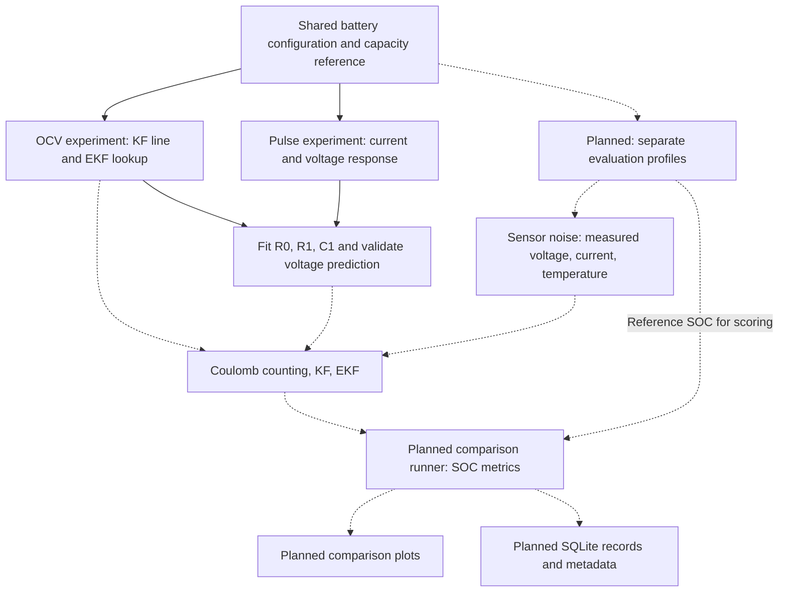

# smart_bms architecture

This document defines where project responsibilities belong and explains the
purpose of each current source file. Update it when files are added, renamed,
or given a new responsibility.

**Finish Phase 1 in Python before starting Arduino implementation.** Phase 1
includes a repeatable simulation-to-estimator comparison, accuracy metrics,
plots, and SQLite storage. Arduino measurements belong to the later hardware
phase. The dashboard, Docker setup, and an Arduino EKF are optional extensions.

## Status labels

- **Implemented:** contains working functions or documentation. This does not
  establish accuracy against the physical battery or completion of the pipeline.
- **Empty placeholder:** exists on disk but contains no implementation. Its
  description below defines its intended responsibility.
- **Planned:** does not exist yet. Listing it here does not create it.

## Current folder structure

```text
smart_bms/
├── architecture.md
├── README.md
├── battery_specs.md
├── quick_notes.md
├── pybamm_practice.py
├── .gitignore
├── python/
│   ├── simulation/
│   │   ├── battery_simulation.py
│   │   ├── sensor_noise.py
│   │   ├── ocv_soc.py
│   │   ├── pulse_test.py
│   │   └── fit_ecm.py
│   ├── estimation/
│   │   ├── coulomb_counter.py
│   │   ├── kalman_filter.py
│   │   └── ekf.py
│   ├── visualization/
│   │   ├── plots.py
│   │   └── dashboard.py
│   ├── database/
│   │   ├── database.py
│   │   └── schema.sql
│   └── tests/
│       ├── test_simulation.py
│       ├── test_fit_ecm.py
│       ├── test_etimators.py
│       └── test_database.py
├── arduino_firmware/
│   ├── bms_monitor.ino
│   ├── sensors.h
│   ├── sensors.cpp
│   ├── calibration.h
│   ├── calibration.cpp
│   ├── serial_protocol.h
│   └── serial_protocol.cpp
└── docker/
    └── docker-compose.yml
```

## Root files: documentation and learning

| File | Status | Purpose |
| --- | --- | --- |
| [architecture.md](architecture.md) | Implemented | Responsibility map, file inventory, data flow, and boundaries for future development. |
| [README.md](README.md) | Implemented | Project introduction, setup/run commands, model assumptions, and roadmap. Dependencies are currently documented here; there is no dependency manifest yet. |
| [battery_specs.md](battery_specs.md) | Implemented | Selected EEMB LP103454 specifications, sources, operating limits, and differences between the physical cell and the Ai2020 simulation surrogate. |
| [quick_notes.md](quick_notes.md) | Implemented | Short learning notes, currently explaining Ah and the simulated 2.153 Ah capacity reference. |
| [pybamm_practice.py](pybamm_practice.py) | Implemented | Standalone learning experiment comparing default-SPM discharge at 0.5C, 1C, and 2C. It uses its own default configuration and is separate from the shared EEMB simulation pipeline. |
| [.gitignore](.gitignore) | Implemented | Excludes generated Python bytecode and cache directories from normal Git tracking. |

## `python/simulation/`: generate battery data and characterize the model

This folder owns the PyBaMM configuration, simulated experiments, sensor noise,
and identification of the simpler voltage model needed by the filters.

| File | Status | Purpose |
| --- | --- | --- |
| [battery_simulation.py](python/simulation/battery_simulation.py) | Implemented | Defines the shared SPM/Ai2020 model, lumped temperature model, battery metadata, and project limits through `create_battery_configuration()`. `run_battery_simulation()` performs the reference discharge to cutoff and returns clean current, voltage, temperature, capacity, and reference SOC. `show_simulation_results()` plots those results. |
| [sensor_noise.py](python/simulation/sensor_noise.py) | Implemented | `add_sensor_noise()` adds repeatable Gaussian noise and fixed bias to clean voltage/current/temperature arrays while retaining the clean reference data. `print_sensor_error_summary()` reports measurement errors. Noise settings are initial assumptions. |
| [ocv_soc.py](python/simulation/ocv_soc.py) | Implemented | Generates rested voltage versus SOC, checks settling, fits the KF's straight OCV line, and builds the EKF's nonlinear OCV lookup and derivative. Its plot compares voltage models with rested samples; it does not show estimated SOC. |
| [pulse_test.py](python/simulation/pulse_test.py) | Implemented | Conditions the battery to a requested reference SOC, then simulates rest, a discharge-current pulse, and recovery. Returns clean measurements, cumulative discharged Ah, phase labels, and current-switch indices/times. Its plot shows the battery's voltage response; fitting belongs to `fit_ecm.py`. |
| [fit_ecm.py](python/simulation/fit_ecm.py) | Implemented | Estimates R0 from both voltage jumps, fits positive R1 and the RC time constant with SciPy, and derives C1. Uses OCV at reference SOC for offline identification. Predicts voltage, reports errors, and validates unchanged parameters on a separate pulse. |

The reference discharge, OCV experiment, and pulse experiment reuse the same
configuration. Their current capacity reference is approximately 2.153 Ah at
0.4 A to 3.0 V in 25°C ambient conditions. This defines the simulated SOC scale;
the physical battery's advertised rating remains 2.0 Ah.

The pulse response is calculated by the electrochemical SPM. R0, R1, and C1
are effective parameters fitted to approximate that response. They are
software model parameters, separate from an external hardware load resistor.

`fit_ecm.py` starts at the final pre-rest sample, where zero initial RC voltage
is assumed. It accounts for OCV changes during discharge and preserves both
sides of the current switches. R0 is fixed to the mean of the two switch
estimates; the optimizer gives pulse and recovery equal influence when fitting
R1 and the time constant. It fits no free voltage offset and checks the initial
OCV mismatch. Broad search bounds and bound-hit status are reported.

`fit_ecm_parameters()` fits supplied pulse data. `predict_ecm_voltage()` is a
voltage predictor from supplied SOC/current, not an SOC estimator.
`evaluate_ecm()` uses fixed parameters without refitting. `run_ecm_fit()` fits
the default 0.4 A/60 s pulse and validates a separate 0.8 A/120 s pulse near
50% SOC. `show_ecm_fit()` displays voltage predictions/errors. The fitted
values are local to the surrogate and test conditions, rather than globally
validated cell parameters. The complete estimator comparison is still pending.

## `python/estimation/`: calculate SOC from measurements

These modules own the estimator mathematics. They accept arrays and model
inputs, then return one SOC estimate per timestamp. They should remain usable
with either simulated measurements or future hardware logs.

| File | Status | Purpose |
| --- | --- | --- |
| [coulomb_counter.py](python/estimation/coulomb_counter.py) | Implemented | `estimate_soc_coulomb_counting()` integrates measured current over elapsed time, using capacity and an initial SOC. This is the baseline, with no voltage correction. |
| [kalman_filter.py](python/estimation/kalman_filter.py) | Implemented | `estimate_soc_kalman_filter()` predicts SOC from current and corrects it using measured voltage, a linear OCV model, and series-resistance compensation. Its single state is SOC. |
| [ekf.py](python/estimation/ekf.py) | Implemented | `estimate_soc_ekf()` estimates SOC and polarization voltage using a nonlinear OCV function, its derivative, and supplied R0/R1/C1 values. Those circuit parameters are fixed during each run. |

These files currently contain no plotting, SQLite access, serial acquisition,
or PyBaMM simulation calls. Temperature is available in simulation data but is
not currently an input to any of these estimators.

## `python/visualization/`: present comparison results

| File | Status | Intended purpose |
| --- | --- | --- |
| [plots.py](python/visualization/plots.py) | Empty placeholder | Reusable plots of reference SOC versus all three estimates, SOC error over time, and metric comparisons. Consume computed results rather than rerunning estimators. |
| [dashboard.py](python/visualization/dashboard.py) | Empty placeholder | Optional interactive interface for viewing measurements and results after the core pipeline works. |

The existing discharge, OCV, pulse, and circuit-fit plots live in their simulation
modules. The empty visualization files do not generate those plots.

## `python/database/`: retain reproducible Phase 1 results in SQLite

| File | Status | Intended purpose |
| --- | --- | --- |
| [database.py](python/database/database.py) | Empty placeholder | Python interface for creating/opening SQLite storage and writing or reading runs, measurements, estimates, and metrics. |
| [schema.sql](python/database/schema.sql) | Empty placeholder | Define SQLite tables, relationships, and constraints so each measurement, estimate, and result can be traced to a run. |

Run metadata should record the profile, battery/model settings, capacity/SOC
reference, noise seed and bias settings, estimator parameters, initialization,
and metric definitions. Store the simulated reference and noisy measurements
separately so evaluation can be reproduced. SQLite storage is required for
Phase 1; it has not been implemented yet.

## `python/tests/`: check correctness automatically

| File | Status | Purpose |
| --- | --- | --- |
| [test_simulation.py](python/tests/test_simulation.py) | Implemented | `unittest` checks for capacity/SOC consistency, voltage cutoff, OCV fitting/interpolation, pulse behavior, and input validation. Includes a small filter-interface check, rather than complete estimator coverage. |
| [test_fit_ecm.py](python/tests/test_fit_ecm.py) | Implemented | Checks voltage prediction against closed-form RC responses, recovery of known circuit parameters, switch handling, invalid inputs, and prediction of a separate PyBaMM pulse without refitting. |
| [test_etimators.py](python/tests/test_etimators.py) | Empty placeholder | Focused checks of Coulomb counting, KF, and EKF using controlled data with known expected behavior, including charge integration, filter updates, and invalid inputs. The current filename is misspelled; the intended spelling is `test_estimators.py`. |
| [test_database.py](python/tests/test_database.py) | Empty placeholder | Check schema creation, saving/loading records, run associations, and preservation of measurement/estimate values. |

`pulse_test.py` is a battery-characterization experiment. The files under
`python/tests/` are automated software checks. The future comparison runner
will measure estimator performance across scenarios; these are three distinct
responsibilities.

## `arduino_firmware/`: acquire hardware measurements in a later phase

All files in this folder are currently empty placeholders. The first hardware
goal is timestamped voltage/current/temperature acquisition, with estimation
remaining offline in Python.

| File | Intended purpose |
| --- | --- |
| [bms_monitor.ino](arduino_firmware/bms_monitor.ino) | Arduino entry point: initialize devices, schedule measurements, and coordinate the acquisition loop. |
| [sensors.h](arduino_firmware/sensors.h) | Declare sensor interfaces and the measurement data shared by the firmware. |
| [sensors.cpp](arduino_firmware/sensors.cpp) | Read voltage, current, and temperature sensors and obtain the raw measurements needed for conversion. |
| [calibration.h](arduino_firmware/calibration.h) | Declare calibration settings and conversion/correction interfaces. |
| [calibration.cpp](arduino_firmware/calibration.cpp) | Apply sensor scaling, offsets, and temperature conversion using measured calibration values. |
| [serial_protocol.h](arduino_firmware/serial_protocol.h) | Define the serial record format and transmission interface, with explicit fields and units. |
| [serial_protocol.cpp](arduino_firmware/serial_protocol.cpp) | Format and transmit timestamped calibrated measurements for a future Python logger. |

No serial protocol, Python serial logger, or firmware control loop currently
exists. Porting the EKF to Arduino is a later stretch goal.

## `docker/`: optional environment support

| File | Status | Intended purpose |
| --- | --- | --- |
| [docker-compose.yml](docker/docker-compose.yml) | Empty placeholder | Optional container/service configuration if the finished workflow needs it. No services are currently defined; SQLite does not require a separate database server. |

## Planned Python additions: files not created yet

These are the intended locations for the remaining pipeline responsibilities.
Implement them one step at a time rather than creating empty files in advance.

| Planned file | Responsibility |
| --- | --- |
| `python/simulation/profiles.py` | Define repeatable evaluation profiles, including changing loads and rest periods, using the shared battery configuration. Keep evaluation profiles separate from characterization data. |
| `python/compare_estimators.py` | Coordinate the Phase 1 experiment: load/generate characterization inputs, simulate an evaluation profile, add sensor noise, run all three estimators on the same measurements, calculate metrics, call comparison plots, and save results/metadata to SQLite. |

The comparison runner will own SOC RMSE, maximum absolute error, convergence
time, and drift calculations. Report SOC RMSE and maximum error in percentage
points, and convergence time in seconds. Record the tolerance and sustained
duration used for convergence, and the interval/units used for drift. A wrong-initial-SOC
case and current-bias case should be repeatable scenarios, not manual edits to
the estimator implementations.

## Intended Phase 1 data flow

The diagram includes planned connections. The complete end-to-end pipeline
does not run yet.



Solid arrows show the existing characterization dependency; dashed arrows
show the intended comparison workflow. The OCV and fitted-circuit inputs apply
to the voltage-based filters; Coulomb counting needs current, capacity, and
initial SOC.

## Shared data conventions and boundaries

| Data | Convention |
| --- | --- |
| Time | Seconds in `time_s`; preserve actual elapsed time and current-switch samples. |
| Current | Amperes; positive means discharge. |
| Voltage | Volts at the battery terminals. OCV lookup values approximate rested voltage. |
| Temperature | Degrees Celsius in returned measurement arrays. |
| SOC | Fraction from 0 to 1 inside calculations; multiply by 100 for percentage displays. |
| Capacity | Ah; use the same `usable_capacity_ah` reference for simulated reference SOC, OCV characterization, and estimator replay. |
| Clean/reference arrays | `current_a`, `voltage_v`, `temperature_c`, `discharge_capacity_ah`, and `true_soc`. |
| Noisy measurement arrays | `measured_current_a`, `measured_voltage_v`, and `measured_temp_c`. |
| Estimator outputs | Time-aligned NumPy SOC arrays, later associated with run and estimator names by the comparison runner. |

- Keep the shared battery configuration in `battery_simulation.py`; avoid
  copying different battery specifications into each experiment.
- Keep characterization/model fitting separate from evaluation. Reference SOC
  can support offline identification and scoring, but the estimators must not
  receive the time-varying `true_soc` array as an input.
- Keep sensor noise separate from clean simulation data so the reference
  remains available and every estimator sees the same noisy readings.
- Keep model identification in simulation modules, filter mathematics in
  estimation modules, and workflow coordination in the comparison runner.
- Keep computation callable without opening plots. Existing simulation modules
  use separate `show_*` functions and direct-execution guards for this purpose.
- Treat Ai2020 as a surrogate for the EEMB cell. Software consistency tests and
  good fits to simulated data do not establish physical-battery accuracy.

Generated `__pycache__/` files, macOS `.DS_Store` files, and `.git/` repository
metadata are infrastructure rather than application modules. Deleted files
and names that survive only in caches are not active parts of this architecture.
