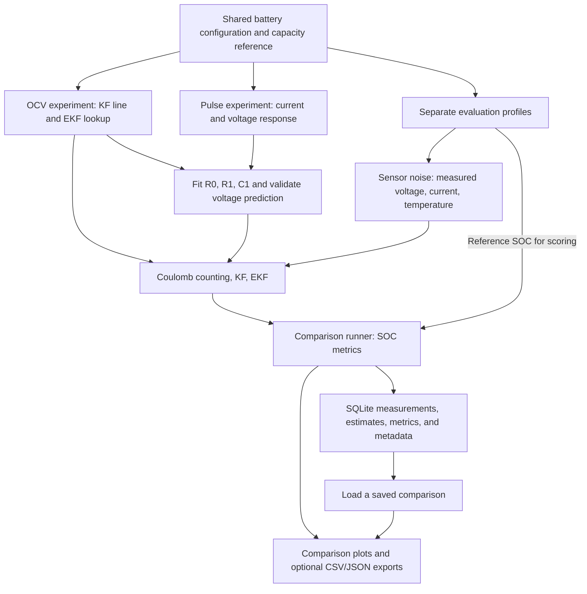

# smart_bms architecture

This document defines where project responsibilities belong and explains the
purpose of each current source file. Update it when files are added, renamed,
or given a new responsibility.

**Finish Phase 1 in Python before starting Arduino implementation.** Phase 1
includes a repeatable simulation-to-estimator comparison, accuracy metrics,
plots, and SQLite storage. Arduino measurements belong to the later hardware
phase. The dashboard, Docker setup, and an Arduino EKF are optional extensions.

## Status labels

- **Implemented:** contains working functions or documentation. This does not
  establish accuracy against the physical battery or completion of the pipeline.
- **Empty placeholder:** exists on disk but contains no implementation. Its
  description below defines its intended responsibility.
- **Planned:** does not exist yet. Listing it here does not create it.

## Current folder structure

```text
smart_bms/
├── architecture.md
├── README.md
├── battery_specs.md
├── quick_notes.md
├── .gitignore
├── python/
│   ├── simulation/
│   │   ├── battery_simulation.py
│   │   ├── sensor_noise.py
│   │   ├── ocv_soc.py
│   │   ├── pulse_test.py
│   │   ├── fit_ecm.py
│   │   └── profiles.py
│   ├── estimation/
│   │   ├── coulomb_counter.py
│   │   ├── kalman_filter.py
│   │   └── ekf.py
│   ├── evaluation/
│   │   └── compare_estimators.py
│   ├── visualization/
│   │   └── plots.py
│   ├── database/
│   │   ├── database.py
│   │   └── schema.sql
│   └── tests/
│       ├── test_simulation.py
│       ├── test_fit_ecm.py
│       ├── test_profiles.py
│       ├── test_comparison.py
│       └── test_database.py
├── arduino_firmware/
│   ├── bms_monitor.ino
│   ├── sensors.h
│   ├── sensors.cpp
│   ├── calibration.h
│   ├── calibration.cpp
│   ├── serial_protocol.h
│   └── serial_protocol.cpp
└── docker/
    └── docker-compose.yml
```

Python source files belong inside the matching responsibility folder under
`python/`; `evaluation/` owns comparison workflow and metrics. The SQLite schema,
database helper, and database tests own persistence. Generated output belongs
under `results/`, which is ignored by Git. Optional features do not need empty
Python files.

## Root files: documentation and repository configuration

| File | Status | Purpose |
| --- | --- | --- |
| [architecture.md](architecture.md) | Implemented | Responsibility map, file inventory, data flow, and boundaries for future development. |
| [README.md](README.md) | Implemented | Project introduction, setup/run commands, model assumptions, and roadmap. Dependencies are currently documented here; there is no dependency manifest yet. |
| [battery_specs.md](battery_specs.md) | Implemented | Selected EEMB LP103454 specifications, sources, operating limits, and differences between the physical cell and the Ai2020 simulation surrogate. |
| [quick_notes.md](quick_notes.md) | Implemented | Short learning notes, currently explaining Ah and the simulated 2.153 Ah capacity reference. |
| [.gitignore](.gitignore) | Implemented | Excludes generated Python bytecode, cache directories, and `results/` output from normal Git tracking. |

## `python/simulation/`: generate battery data and characterize the model

This folder owns the PyBaMM configuration, simulated experiments, sensor noise,
and identification of the simpler voltage model needed by the filters.

| File | Status | Purpose |
| --- | --- | --- |
| [battery_simulation.py](python/simulation/battery_simulation.py) | Implemented | Defines the shared SPM/Ai2020 model, lumped temperature model, battery metadata, and project limits through `create_battery_configuration()`. `run_battery_simulation()` performs the reference discharge to cutoff and returns clean current, voltage, temperature, capacity, and reference SOC. `show_simulation_results()` plots those results. |
| [sensor_noise.py](python/simulation/sensor_noise.py) | Implemented | `add_sensor_noise()` adds configurable, seeded Gaussian noise and fixed bias while retaining clean arrays. Returns the settings used; `print_sensor_error_summary()` reports errors. Noise settings are initial assumptions. |
| [ocv_soc.py](python/simulation/ocv_soc.py) | Implemented | Generates rested voltage versus SOC, checks settling, fits the KF's straight OCV line, and builds the EKF's nonlinear OCV lookup and derivative. Its plot compares voltage models with rested samples; it does not show estimated SOC. |
| [pulse_test.py](python/simulation/pulse_test.py) | Implemented | Conditions the battery to a requested reference SOC, then simulates rest, a discharge-current pulse, and recovery. Returns clean measurements, cumulative discharged Ah, phase labels, and current-switch indices/times. Its plot shows the battery's voltage response; fitting belongs to `fit_ecm.py`. |
| [fit_ecm.py](python/simulation/fit_ecm.py) | Implemented | Estimates R0 from both voltage jumps, fits positive R1 and the RC time constant with SciPy, and derives C1. Uses OCV at reference SOC for offline identification. Predicts voltage, reports errors, and validates unchanged parameters on a separate pulse. |
| [profiles.py](python/simulation/profiles.py) | Implemented | Defines constant-discharge, changing-load, and charge/discharge evaluation profiles with rest periods. `run_test_profile()` conditions the shared model to a requested SOC, excludes preparation from evaluation, preserves current switches, and checks cutoff/step completion. `show_test_profile()` plots clean measurements and reference SOC. |

The reference discharge, OCV experiment, and pulse experiment reuse the same
configuration. Their current capacity reference is approximately 2.153 Ah at
0.4 A to 3.0 V in 25°C ambient conditions. This defines the simulated SOC scale;
the physical battery's advertised rating remains 2.0 Ah.

The pulse response is calculated by the electrochemical SPM. R0, R1, and C1
are effective parameters fitted to approximate that response. They are
software model parameters, separate from an external hardware load resistor.

`fit_ecm.py` starts at the final pre-rest sample, where zero initial RC voltage
is assumed. It accounts for OCV changes during discharge and preserves both
sides of the current switches. R0 is fixed to the mean of the two switch
estimates; the optimizer gives pulse and recovery equal influence when fitting
R1 and the time constant. It fits no free voltage offset and checks the initial
OCV mismatch. Broad search bounds and bound-hit status are reported.

`fit_ecm_parameters()` fits supplied pulse data. `predict_ecm_voltage()` is a
voltage predictor from supplied SOC/current, not an SOC estimator.
`evaluate_ecm()` uses fixed parameters without refitting. `run_ecm_fit()` fits
the default 0.4 A/60 s pulse and validates a separate 0.8 A/120 s pulse near
50% SOC. `show_ecm_fit()` displays voltage predictions/errors. The fitted
values are local to the surrogate and test conditions, rather than globally
validated cell parameters. Evaluation profiles remain separate from these
characterization experiments and never enter the fitting optimizer.

## `python/evaluation/`: coordinate the software comparison

[compare_estimators.py](python/evaluation/compare_estimators.py) is implemented.
`run_comparison()` characterizes the model once, generates each evaluation
profile near 50% SOC, adds noise, and calls all three estimators with the same
measured arrays and capacity reference. It returns measurements, estimates,
metrics, characterization results, and settings. It does not change estimator
equations or tune filters against the evaluation SOC reference.

Each profile has three scenarios: nominal initialization at 50%, an initial
estimate of 40% using the identical measurements, and an increased current
offset of +50 mA instead of +10 mA. The bias scenario preserves the random
noise realization and voltage/temperature measurements. Each profile's noise
seed is recorded; by default it is the supplied seed plus its position in the
requested profile list.

`calculate_soc_metrics()` reports:

- Time-weighted SOC RMSE and maximum absolute sampled error, in percentage points.
- Convergence time: the first sampled time within ±2 percentage points followed
  by at least 60 seconds continuously inside that band. `None` means no
  qualifying interval was demonstrated; zero means it began at the first sample.
- Drift: a time-weighted linear trend in signed error over the final 300 seconds,
  in percentage points/hour. The window boundary is interpolated and the exact
  interval is returned. This is a local trend, not a long-term drift prediction.

The tolerance, hold duration, and drift window are configurable. Explicit,
fixed filter settings are reused across scenarios. `print_comparison_summary()`
prints the metrics, and `save_comparison_summary()` optionally exports
`metrics.csv` and `metadata.json`. The CLI calls the shared plotting function
and can save PNGs without opening windows. It saves full comparison results to
`results/smart_bms.sqlite3` by default, using the database helpers below.

From the repository root, run `python -m python.evaluation.compare_estimators`.
Direct execution via `python python/evaluation/compare_estimators.py` is also
supported. `--database PATH` changes the storage location; `--no-store` skips
SQLite writing. `--load-id ID` reopens a comparison from the chosen database,
prints its stored metrics, and plots its stored estimates without simulation,
filter execution, or insertion of another comparison. Both normal and loaded
results support `--save-dir` exports and `--no-show` headless execution.

These short profiles cover only a few SOC percentage points near the pulse fit.
The global straight OCV line can bias the KF; neither filter is guaranteed to
outperform correctly initialized Coulomb counting on a short test. Charge
behavior is evaluated using parameters fitted from discharge pulses. These are
local surrogate comparisons, not full-range or hardware accuracy claims.

## `python/estimation/`: calculate SOC from measurements

These modules own the estimator mathematics. They accept arrays and model
inputs, then return one SOC estimate per timestamp. They should remain usable
with either simulated measurements or future hardware logs.

| File | Status | Purpose |
| --- | --- | --- |
| [coulomb_counter.py](python/estimation/coulomb_counter.py) | Implemented | `estimate_soc_coulomb_counting()` integrates measured current over elapsed time, using capacity and an initial SOC. This is the baseline, with no voltage correction. |
| [kalman_filter.py](python/estimation/kalman_filter.py) | Implemented | `estimate_soc_kalman_filter()` predicts SOC from current and corrects it using measured voltage, a linear OCV model, and series-resistance compensation. Its single state is SOC. |
| [ekf.py](python/estimation/ekf.py) | Implemented | `estimate_soc_ekf()` estimates SOC and polarization voltage using a nonlinear OCV function, its derivative, and supplied R0/R1/C1 values. Those circuit parameters are fixed during each run. |

These files currently contain no plotting, SQLite access, serial acquisition,
or PyBaMM simulation calls. Temperature is available in simulation data but is
not currently an input to any of these estimators.

## `python/visualization/`: present comparison results

| File | Status | Intended purpose |
| --- | --- | --- |
| [plots.py](python/visualization/plots.py) | Implemented | `plot_estimator_comparison()` consumes completed results and creates one figure per profile: reference/estimated SOC above signed SOC error, with a column for each scenario, RMSE labels, and convergence-tolerance guides. Optionally saves PNGs and opens windows; returns the figures. |

The existing discharge, OCV, pulse, and circuit-fit plots live in their simulation
modules. An interactive dashboard is an optional future extension; it has no
source file yet.

## `python/database/`: retain reproducible Phase 1 results in SQLite

| File | Status | Purpose |
| --- | --- | --- |
| [database.py](python/database/database.py) | Implemented | `initialize_database(path)` creates the schema, `save_comparison(path, results)` appends one complete comparison and returns its ID, `load_comparison(path, id)` restores the comparison dictionary and NumPy arrays, and `list_comparisons(path)` lists IDs, creation times, and scenario counts. Uses standard-library `sqlite3`. |
| [schema.sql](python/database/schema.sql) | Implemented | Defines five related tables with foreign keys and sample-based associations, preserving the relationship between an experiment, its scenarios, measurements, estimator outputs, and metrics. |

The storage hierarchy is:

- `comparisons`: one complete experiment, such as a single CLI invocation;
  includes creation time and comparison-level settings/characterization metadata.
- `scenarios`: one profile and initialization/noise case within that experiment;
  retains scenario and measurement metadata.
- `measurements`: clean current (A), terminal voltage (V), temperature (°C),
  discharged capacity (Ah), reference SOC (fraction), and noisy sensor readings
  at each time (s). Sample index determines order and identifies samples;
  timestamps need not be unique.
- `estimates`: estimated SOC (fraction) by scenario, estimator, and sample index.
- `metrics`: each estimator's summary for a scenario, including RMSE/maximum
  error (SOC percentage points), convergence (s), and drift (percentage
  points/hour). A missing convergence time is SQL `NULL`, not a zero.

Each save appends a new comparison in one transaction. Foreign-key checks
protect associations; a failed save must not leave a partial comparison behind.
JSON metadata preserves additional NumPy arrays and characterization results,
along with battery/model settings, the capacity/SOC reference, noise seed and
bias settings, estimator inputs, initialization, metric definitions, and software
versions.
Loading restores data for the existing summary, metric, and plotting functions;
it does not regenerate measurements or estimates. The database is local and
requires no server or additional Python dependency.

## `python/tests/`: check correctness automatically

| File | Status | Purpose |
| --- | --- | --- |
| [test_simulation.py](python/tests/test_simulation.py) | Implemented | `unittest` checks for capacity/SOC consistency, voltage cutoff, OCV fitting/interpolation, pulse behavior, and input validation. Includes a small filter-interface check, rather than complete estimator coverage. |
| [test_fit_ecm.py](python/tests/test_fit_ecm.py) | Implemented | Checks voltage prediction against closed-form RC responses, recovery of known circuit parameters, switch handling, invalid inputs, and prediction of a separate PyBaMM pulse without refitting. |
| [test_profiles.py](python/tests/test_profiles.py) | Implemented | Checks all evaluation profiles, charge/discharge SOC integration, settled preparation, preserved switch samples, shared reference capacity, invalid settings, and cutoff rejection. |
| [test_comparison.py](python/tests/test_comparison.py) | Implemented | Checks metrics against known errors and irregular timestamps, convergence/hold semantics, drift windows, configurable noise, and a real comparison run. Verifies shared measurements, isolated bias changes, and measured-only estimator inputs without requiring any estimator to win. |
| [test_database.py](python/tests/test_database.py) | Implemented | Checks schema creation, complete comparison round trips, measurement/estimate preservation, sample ordering, nullable convergence, comparison associations, and transactional storage behavior. |

`pulse_test.py` is a battery-characterization experiment. The files under
`python/tests/` are automated software checks. The comparison runner
measures estimator performance across scenarios; these are three distinct
responsibilities.

## `arduino_firmware/`: acquire hardware measurements in a later phase

All files in this folder are currently empty placeholders. The first hardware
goal is timestamped voltage/current/temperature acquisition, with estimation
remaining offline in Python.

| File | Intended purpose |
| --- | --- |
| [bms_monitor.ino](arduino_firmware/bms_monitor.ino) | Arduino entry point: initialize devices, schedule measurements, and coordinate the acquisition loop. |
| [sensors.h](arduino_firmware/sensors.h) | Declare sensor interfaces and the measurement data shared by the firmware. |
| [sensors.cpp](arduino_firmware/sensors.cpp) | Read voltage, current, and temperature sensors and obtain the raw measurements needed for conversion. |
| [calibration.h](arduino_firmware/calibration.h) | Declare calibration settings and conversion/correction interfaces. |
| [calibration.cpp](arduino_firmware/calibration.cpp) | Apply sensor scaling, offsets, and temperature conversion using measured calibration values. |
| [serial_protocol.h](arduino_firmware/serial_protocol.h) | Define the serial record format and transmission interface, with explicit fields and units. |
| [serial_protocol.cpp](arduino_firmware/serial_protocol.cpp) | Format and transmit timestamped calibrated measurements for a future Python logger. |

No serial protocol, Python serial logger, or firmware control loop currently
exists. Porting the EKF to Arduino is a later stretch goal.

## `docker/`: optional environment support

| File | Status | Intended purpose |
| --- | --- | --- |
| [docker-compose.yml](docker/docker-compose.yml) | Empty placeholder | Optional container/service configuration if the finished workflow needs it. No services are currently defined; SQLite does not require a separate database server. |

## Remaining Phase 1 work

The local simulation-to-estimator pipeline now includes plots, metrics, and
SQLite save/load. Add focused estimator unit checks to the existing tests or
introduce a correctly named `test_estimators.py` when implementing those checks.
Then broaden SOC/temperature profiles and circuit-model validation without
mixing fitting data into evaluation. Passing local software checks does not
establish full-range SOC accuracy or replace physical-cell validation.

## Intended Phase 1 data flow

Simulation, estimation, metrics, plots, and SQLite persistence run end to end.
Saved results can also be reopened for inspection without rerunning simulation
or estimation.



Solid arrows show implemented data flow. The OCV and fitted-circuit inputs apply
to the voltage-based filters; Coulomb counting needs current, capacity, and
initial SOC.

## Shared data conventions and boundaries

| Data | Convention |
| --- | --- |
| Time | Seconds in `time_s`; preserve actual elapsed time and current-switch samples. |
| Current | Amperes; positive means discharge. |
| Voltage | Volts at the battery terminals. OCV lookup values approximate rested voltage. |
| Temperature | Degrees Celsius in returned measurement arrays. |
| SOC | Fraction from 0 to 1 inside calculations; multiply by 100 for percentage displays. |
| Capacity | Ah; use the same `usable_capacity_ah` reference for simulated reference SOC, OCV characterization, and estimator replay. |
| Clean/reference arrays | `current_a`, `voltage_v`, `temperature_c`, `discharge_capacity_ah`, and `true_soc`. |
| Noisy measurement arrays | `measured_current_a`, `measured_voltage_v`, and `measured_temp_c`. |
| Estimator outputs | Time-aligned NumPy SOC arrays, associated with profile, scenario, and estimator names by the comparison runner. |

- Keep the shared battery configuration in `battery_simulation.py`; avoid
  copying different battery specifications into each experiment.
- Keep characterization/model fitting separate from evaluation. Reference SOC
  can support offline identification and scoring, but the estimators must not
  receive the time-varying `true_soc` array as an input.
- Keep sensor noise separate from clean simulation data so the reference
  remains available and every estimator sees the same noisy readings.
- Keep model identification in simulation modules, filter mathematics in
  estimation modules, and workflow coordination and metrics in `evaluation/`.
- Keep computation callable without opening plots. Existing simulation modules
  use separate `show_*` functions and direct-execution guards for this purpose.
- Treat Ai2020 as a surrogate for the EEMB cell. Software consistency tests and
  good fits to simulated data do not establish physical-battery accuracy.

Generated `__pycache__/` files, macOS `.DS_Store` files, and `.git/` repository
metadata are infrastructure rather than application modules. Deleted files
and names that survive only in caches are not active parts of this architecture.
